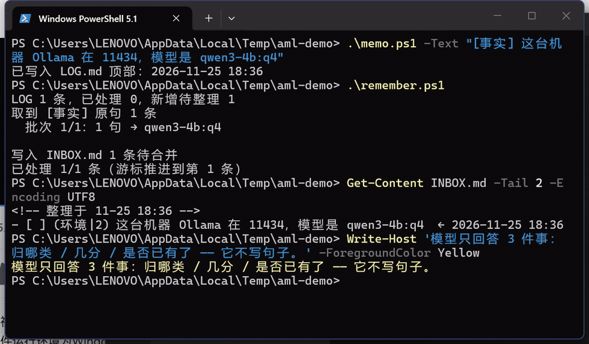

# agent-memory-layer

> **给 AI agent 的磁盘记忆层：模型只做分类，不写句子。**
> **90 行封顶，一次调用出快照，零云依赖。记忆库里没有一个字是模型编的。**
>
> Markdown files as long-term memory for an LLM agent. The model *classifies*, it never *writes*.

会话一关，上下文就没了。这个仓库解决的就是那一件事：**让 agent 在下一轮开工时，用一次调用记住该记住的东西，而且记下来的每个字都是人写的原话，不是模型编的。**

不是向量库，不是 RAG，不是数据库。五个 Markdown 文件 + 六个 PowerShell 脚本，零云依赖，本地跑。



> 23 秒一次完整链路：写一条 `[事实]` → 本地 4B 模型只回答「归哪类、几分、是否已有了」→ `INBOX.md` 里落的是**原句，一字未改**。（[MP4 版](docs/demo.mp4)，无声）

---

## 问题

| 做法 | 为什么不行 |
|---|---|
| 把历史全塞进上下文 | 线性增长，几十轮后开始挤掉真正有用的东西 |
| 让模型总结历史再存 | 模型会瞎编，压缩一次错一次，错的东西还会被当成事实反复引用 |
| 向量库 + RAG | 对「这台机器端口是多少」这种精确事实，相似度检索不如直接读文件；而且多一套服务要维护 |
| 什么都存 | 记忆库三个月后变成垃圾场，开工读它比不读还慢 |

## 三条设计决定

1. **模型只打标，不造句。** 写日志时人（或 agent）自己标 `[事实]` / `[动作]`；模型只回答「这条归哪类、值几分、是不是已经有了」。写进 `INBOX.md` 的文本一律取**原句**。模型的输出只能决定「留不留」，不能决定「写什么」。
2. **预算封顶。** `MEMORY.md` 90 行，超了先合并再写，老条目进 `ARCHIVE.md`。记忆库的敌人不是容量，是熵。
3. **一次调用出快照。** 开工不是读 4 个文件（4 次往返、4 份工具开销），而是一条命令吐完 `MEMORY + PENDING + INBOX + LOG 尾部`。

## 这个和现成的有什么区别

先说实话：**「用 Markdown 给 agent 做记忆」这件事已经有人做了，而且做得不小。** 如果你的问题是「海量对话怎么语义检索」，去用 [mem0](https://github.com/mem0ai/mem0) 或 [memsearch](https://github.com/zilliztech/memsearch)，它们更合适。

这个仓库只解决一件事：**记住几十到上百条必须精确命中的事实，且保证记下来的每个字都是人写的原话。**

所以差异只有两条，其余都是实现：

| | 主流方案怎么做的 | 这个仓库怎么做的 |
|---|---|---|
| **谁来写记忆文本** | LLM 从对话里抽取、总结、改写（mem0 / langmem / cognee / graphiti / memoryrepo 全是这个路子） | **模型不写句子**。它只回答「这条留不留、归哪类、打几分」，写进文件的文本 100% 是原始 `[事实]` 原句 |
| **怎么防膨胀** | 语义去重、后台合并（mem0 有 update/delete，letta 的 core memory 有约 2000 字符上限） | **90 行硬预算 + `!!` 告警 + 归档淘汰**，纯脚本，无后台常驻服务 |

关键区别是第一条。让模型总结记忆，等于在记忆上再叠一层幻觉：它总结错了，错的版本会被当成事实反复引用下去，而且**没有任何人会发现**（因为原始那句已经不在文件里了）。这个仓库把模型的可写权限直接砍掉 —— 它最多让一条事实晚一轮入库，没办法把假话写进记忆。

### Related work（就近的几个）

| 项目 | 它是什么 | 和这里的差别 |
|---|---|---|
| [memoryrepo](https://github.com/supermemoryai/memoryrepo) | `MEMORY.md` 入口 + 主题文件 + 每次写入一个 commit，后台 agent 合并裁剪 | 理念最接近；但它让后台 agent **改写**记忆文本，我们不让 |
| [agent-memory-template](https://github.com/agentconnect-md/agent-memory-template) | 纯 Markdown + Git 的模板，零依赖 | 最接近的轻量方案；它没有模型分类与入库门控 |
| [basic-memory](https://github.com/basicmachines-co/basic-memory) | 本地 Markdown（Obsidian 兼容）+ SQLite 索引 + MCP 工具 | 定位偏知识库累积，不控熵 |
| [ai-memory](https://github.com/akitaonrails/ai-memory) | Git 仓 Markdown wiki + SQLite FTS5 + 本地 embedding，默认零 LLM | 工程完整度高得多；它靠生命周期钩子自动抓会话，不靠人工打标 |
| [letta / MemGPT](https://github.com/letta-ai/letta) | 分层内存：常驻 core memory（有字符上限）+ 归档 | 「有预算的核心记忆」这个想法一致；但 core memory 由 agent 自己 `append/replace` |
| [mem0](https://github.com/mem0ai/mem0) | 向量库 + LLM 自动抽取 facts，可上图库 | 目标相同，路径正相反 |
| [Zep / Graphiti](https://github.com/getzep/graphiti) | 时序知识图谱，事实失效标 `invalid_at` | 解决「新旧事实冲突」比我们严谨，代价是一整套图数据库 |

> 更完整的 12 个项目对照（含 star 数、更新日期、存储形态、谁写记忆文本）见 [docs/PRIOR-ART.md](docs/PRIOR-ART.md)。

## 怎么工作

```mermaid
flowchart TD
    A[工作过程中写 LOG.md<br/>每条 bullet 自带 事实/动作 标记] --> B[remember.ps1<br/>取未处理段落]
    B --> C{只要有 [事实] 原句}
    C -->|无| Z[游标前移, 结束]
    C -->|有| D[本地小模型 Ollama<br/>只回答: 类别 / 分数 / 是否已覆盖]
    D --> E[机械去重 + 阈值过滤<br/>MinScore 默认 2]
    E --> F[INBOX.md<br/>原句直取, 零改写]
    F --> G[人工/agent 审核<br/>够长期的并进 MEMORY.md]
    G --> H[MEMORY.md 90 行预算]
    H -->|超预算| I[合并压缩 -> ARCHIVE.md]
    J[开工] --> K[recall.ps1 一次调用]
    K --> L[快照: MEMORY + PENDING + INBOX + LOG尾15行<br/>约 4-5k token / 0.3s]
```

## 快速开始

```powershell
git clone <this-repo> C:\memory
cd C:\memory

# 1. 铺模板（已存在的不覆盖）
powershell -NoProfile -ExecutionPolicy Bypass -File init.ps1

# 2. 先写一条流水：在 LOG.md 里加 ## 时间戳 段落，bullet 前标 [事实]
#    例：- [事实] 这台机器 Ollama 监听 127.0.0.1:11434

# 3. 整理（先干跑看清楚会发生什么）
powershell -NoProfile -ExecutionPolicy Bypass -File remember.ps1 -DryRun

# 4. 真跑
powershell -NoProfile -ExecutionPolicy Bypass -File remember.ps1

# 5. 看快照
powershell -NoProfile -ExecutionPolicy Bypass -File recall.ps1
```

依赖只有两样：**PowerShell 5.1+** 和 **Ollama**（`ollama serve`，默认 11434）。模型默认 `qwen3-4b:q4`（3.3 GB 显存，100 tok/s），换模型用 `-Model` 或环境变量 `AMEM_MODEL`。

## 平台支持

| 平台 | 实现 | 状态 |
|---|---|---|
| Windows | `*.ps1` + 计划任务（`install-task.ps1`） | 生产跑了 1 个多月 |
| Linux / macOS | `linux/*.sh`（bash + curl + python3/jq） | 自测 **40 项全过**，接真 Ollama 端到端验证过 |

### Linux / macOS 快速开始

```bash
git clone <this-repo> ~/memory && cd ~/memory

# 1. 铺模板
bash linux/init.sh

# 2. 写一条流水：在 LOG.md 里加 ## 时间戳 段落，bullet 前标 [事实]
#    例：- [事实] 这台机器 Ollama 监听 127.0.0.1:11434

# 3. 干跑 → 真跑 → 看快照
bash linux/remember.sh --dry-run
bash linux/remember.sh
bash linux/recall.sh

# 4. 自测（不需要真 Ollama，内置 mock 服务）
bash linux/selftest.sh
```

依赖：`bash` + `curl` + (`python3` 或 `jq`)。**注意**：Windows 上的 python 默认按 cp936 输出，会把中文 JSON 变成 GBK 字节 —— `linux/*.sh` 里已统一 `export PYTHONUTF8=1 PYTHONIOENCODING=utf-8`，自己写脚本时记得照抄这一行。

## 五个文件，各管一件事

| 文件 | 内容 | 谁写 | 谁读 |
|---|---|---|---|
| `MEMORY.md` | 会一直成立的事实（身份/环境/口径/坑），**90 行封顶** | 人 / agent 审核后 | 每轮开工 |
| `PENDING.md` | 在办事项，`[ ]` `[~]` `[x]` | 随时 | 每轮开工 |
| `LOG.md` | 流水，`[事实]` / `[动作]` 打标 | 边说边写 | 整理时 + 尾部 15 行 |
| `INBOX.md` | 待合并的候选（原句，未经改写） | `remember.ps1` | 每轮开工，非空就合并 |
| `ARCHIVE.md` | 过期流水，只读 | `remember.ps1 -Prune` | grep 时才看 |

## 六个脚本

| 脚本 | 作用 |
|---|---|
| `init.ps1` | 模板 → 真实文件（不覆盖已有） |
| `recall.ps1` | **一次调用**输出快照 + 自己的体积/token 估算 + 预算告警 |
| `memo.ps1` | 手工写入 / 检索（`-Kind log\|mem\|pending -Text "..."`、`-Search 关键词`） |
| `remember.ps1` | 增量整理：取 `[事实]` → 本地模型分类 → 写 `INBOX.md`；`-Prune` 归档老化流水；`-DryRun` 只看不写 |
| `ai.ps1` | Ollama 单次问答（模型接口层，可单独当 CLI 用；`-Fmt json` 走结构化输出） |
| `install-task.ps1` | 注册/卸载计划任务（`-Mode on\|off\|status`） |

Linux / macOS 用 `linux/` 下的同名 bash 版：`init.sh` / `recall.sh` / `remember.sh` / `memo.sh` / `ai.sh`，外加一个 `selftest.sh`。参数与 PowerShell 版逐条对齐（`--dry-run`、`--prune`、`--min-score`、`--batch-size`、`--days-keep-log`……）。

## 文档

| 文件 | 内容 |
|---|---|
| [docs/ARCHITECTURE.md](docs/ARCHITECTURE.md) | 数据流、状态机、扩展点、为什么不用数据库 |
| [docs/WHY-NOT-RAG.md](docs/WHY-NOT-RAG.md) | 正面回答「为什么不用向量库」 |
| [docs/PRIOR-ART.md](docs/PRIOR-ART.md) | 12 个同类项目的对照（含 star 数、更新日期、谁写记忆文本） |
| [docs/DEMO.md](docs/DEMO.md) | 90 秒演示的分镜表与录制准备 |
| [prompts/agent-memory-snippet.md](prompts/agent-memory-snippet.md) | 粘进任意 agent 系统提示词就能用起来的一段 |
| `HANDOFF.md` | Linux 移植的交付说明（由协作 agent 写的） |

## 实测

一台 Windows 11 + Ryzen + RTX 5060 的机器上：

| 指标 | 数值 |
|---|---|
| 开工快照 | 6.3 千字符 ≈ 4–5 千 token，**0.3 秒** |
| 对比逐个读 4 个文件 | 4 次工具往返 + 4 份输出开销 |
| 整理 60 天流水 | 本地模型分类，**0 云端 token** |
| 模型输出对事实文本的改写 | **0**（文本来自原句，模型只给标签） |
| 记忆库规模 | `MEMORY.md` 71 行 / 14 KB，跑了一个多月 |
| Linux 版自测 | 40 项断言全过（`linux/selftest.sh`，内置 mock Ollama，不需联网） |
| Linux 版接真模型 | 2 条 `[事实]` → 1 条入 INBOX（另一条模型漏标，如实报「待人工看」），二次运行幂等 |

## 调度

```powershell
# 每天 23:40 整理一次；关机错过的，登录后 5 分钟自动补跑
powershell -NoProfile -ExecutionPolicy Bypass -File install-task.ps1 -Mode on
powershell -NoProfile -ExecutionPolicy Bypass -File install-task.ps1 -Mode status
```

不用 Windows 的话，等价的一行 cron：

```cron
40 23 * * * pwsh -NoProfile -File /home/you/memory/remember.ps1 -Prune >> /home/you/memory/digest.log 2>&1
```

## 坑（都是踩过的）

1. **PowerShell 5.1 默认按 GBK 读 `.ps1`。** 脚本里有中文就必须存成 **UTF-8 带 BOM**，否则报语法错，错得莫名其妙。
2. **写文件用 `UTF8Encoding($false)`，不要带 BOM。** `.md` 带 BOM 在某些渲染器里会把第一行当正文吃掉。读写两条规矩不一样，别混。
3. **上游错，下游必错。** 本地小模型会原样照抄输入里的错词（转写把「AI 味」听成 ARWIR，它就把 ARWIR 抄进笔记）。所以它只配打标，不配写句子。
4. **游标卡死。** 一段流水里全是 `[动作]` 时也要前移游标，否则下次还在处理同一段。
5. **别让模型判「值不值得记」。** 判断放写日志那一刻（打标），模型只做归类 —— 这是精度来源。
6. **PowerShell 变量名大小写不敏感。** `$logLines = ...` 会直接覆盖脚本里的 `[int]$LogLines = 15` 参数，报 `Cannot convert System.String[] to System.Int32`，而且是**非终止错误**：脚本继续跑，只是 LOG 尾部再也不显示。这 bug 在作者的机器上活了一个多月才被发现，因为它的表现是「输出里少了一节」，不是报错。
7. **`format: "json"` 不够。** Ollama 只保证「是合法 JSON」，小模型照样会回单个对象、漏掉编号，`[regex]` 找数组就整批作废。**要传完整 JSON Schema 当解码语法**（`ai.ps1 -Schema`，根节点声明成 array + required 字段），实测这一步把成功率从 0 拉到 100%。

## 它不管什么

- 不管海量语料与开放式语义检索 —— 那种需求用 [mem0](https://github.com/mem0ai/mem0)、[memsearch](https://github.com/zilliztech/memsearch)
- 不管检索排序（就 90 行，读完比搜完快）
- 不管多用户 / 权限
- 不管跨机器同步（`git` 或者网盘，自己看着办）
- 不替你判断什么该记 —— 那是你的口径，不是工具的事

## Roadmap

- [ ] Linux / macOS 分支（当前只有 PowerShell + Windows 计划任务）
- [ ] `MEMORY.md` 超预算时的半自动合并建议（本地模型给候选合并对，人点确认）
- [ ] 可插拔的模型后端（OpenAI 兼容端点 / 任意 Ollama 实例）
- [ ] `LOG.md` 的 `[事实]` 打标可以由 agent 系统提示词约束，附一份提示词片段

## License

MIT
