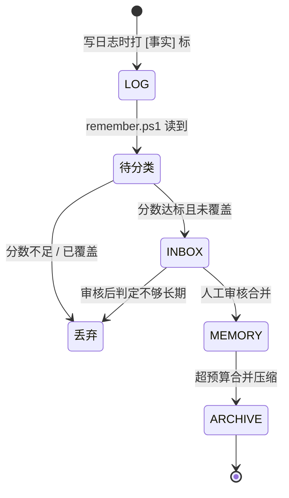

# 架构

## 组成

```
agent-memory-layer/
├── MEMORY.md          长期事实（90 行预算）      ← 人/agent 审核后写入
├── PENDING.md         在办
├── LOG.md             流水（[事实]/[动作] 打标） ← 边说边写
├── INBOX.md           候选（原句，未改写）       ← remember.ps1 写
├── ARCHIVE.md         过期流水
├── .digest-state.json 游标：processed / lastStamp / updatedAt / model
├── recall.ps1         读路径：一次调用出快照
├── remember.ps1       写路径：分类 + 去重 + 落 INBOX / 归档
├── memo.ps1           手工读写入
├── ai.ps1             模型接口层（Ollama）
├── init.ps1           模板初始化
├── install-task.ps1   计划任务
└── digest-run.cmd     计划任务入口（remember.ps1 -Prune + 追加日志）
```

数据是纯文本，没有 schema 迁移、没有锁、没有服务。**唯一的状态是 `.digest-state.json` 里一个整数。**

## 写路径（remember.ps1）

```
读 .digest-state.json ──> processed = 已处理段落数
        │
        ▼
解析 LOG.md 成段落（以 `## yyyy-MM-dd HH:mm` 为界）
        │
        ├─ 段数 <= processed ──> "没有新流水" 退出（不动游标）
        │
        ▼
新段落（最新在前）里逐行取 bullet
        │
        ├─ [事实] / [fact] ──> 收（长度 >= 8）
        ├─ [动作] / [进度] ──> 默认丢；-All 才收
        └─ 无标记           ──> 丢
        │
        ▼
批次（BatchSize 默认 10）送本地模型
        提示词要它只输出结构化判断：类别(身份/环境/口径/坑) + 分数 + 是否已覆盖
        │
        ▼
机械去重（和 MEMORY.md / INBOX.md 已有行做包含比对）
        │
        ▼
分数 >= MinScore（默认 2）且未覆盖 ──> 追加进 INBOX.md（**原句，零改写**）
        │
        ▼
写回游标：processed = 本次段落总数
```

关键点：**模型的输出只决定「进不进 INBOX」，不参与生成 INBOX 里的文本。** 模型胡说了类别或分数，最多让一条事实晚一轮入库；它没机会把假话写进记忆。

## 读路径（recall.ps1）

```
recall.ps1 [-LogLines 15] [-Full]
   ├─ MEMORY.md     全文
   ├─ PENDING.md    全文
   ├─ INBOX.md      非空才输出（附待合并条数）
   └─ LOG.md        尾部 N 行
   ↓
末尾一行自报体积：[快照 6300 字符，约 3937-5250 token；MEMORY 预算 90 行，现在 71 行]
```

自报体积是有意的：**让 agent 自己看见这次开工花了多少上下文**。超过 90 行时打 `!!` 告警，逼先合并。

## 状态机（一条事实的一生）



## 扩展点

| 想改什么 | 改哪 |
|---|---|
| 换模型 | `-Model` / `AMEM_MODEL`，或 `-aiP`（环境变量 `AMEM_AI_PS1`）指向别的接口脚本 |
| 换分类体系 | `remember.ps1` 里的 `$sysPrompt` 字符串（类别枚举） |
| 换入库门槛 | `-MinScore` |
| 换保留期 | `-Prune -DaysKeepLog 90` |
| 换语言/平台 | 三个脚本合计约 500 行，全是文件读写 + 一次 HTTP，移植成本低 |
| 让别的 agent 也能用 | 把 `recall.ps1` 的逻辑翻成一行 `cat`，或直接让 agent 读三个文件 —— 诚实说，文件本身就是接口 |

## 为什么不用数据库

90 行的事实库，读全文 0.3 秒。引入 SQLite 只换来「查询更快」，代价是 agent 得学一套新工具、人得开一个新客户端、备份得多想一步。**在数据量到这个量级之前，纯文本就是最优解；到量级之后，该拆的是记忆的分类，不是换成数据库。**
